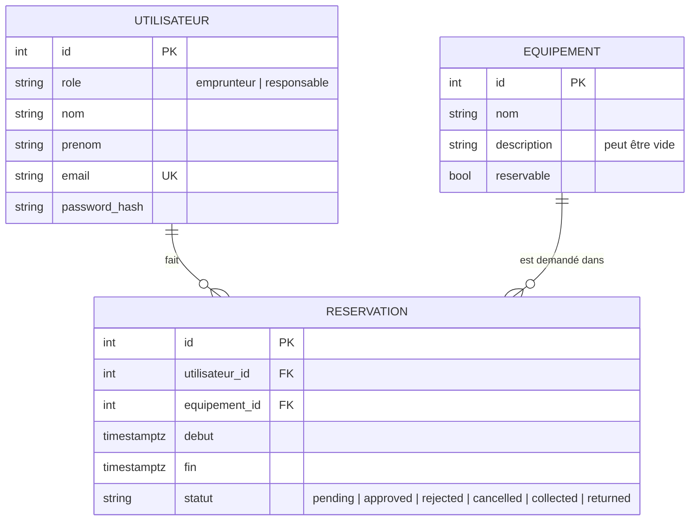

# Modèle de données

Schéma validé avant tout code (P02). Les règles métier qui l'expliquent sont dans [`rules.md`](rules.md).

## Schéma

Lecture : un utilisateur a zéro ou plusieurs réservations ; un équipement apparaît dans zéro ou plusieurs réservations ; une réservation concerne exactement un utilisateur et un équipement. La liaison « qui a quoi » vit uniquement dans `reservation`.

## Contraintes

Posées dans la base, pas seulement dans le code : la base est la dernière ligne de défense.

- Toutes les colonnes sont `NOT NULL`, sauf `equipement.description`.
- `utilisateur.email` est unique.
- `utilisateur.role` et `reservation.statut` n'acceptent que les valeurs listées ci-dessus.
- `reservation.fin > reservation.debut`.
- Clés étrangères : la suppression d'un utilisateur ou d'un équipement référencé par une réservation est refusée.

## Décisions

- **Dates en UTC** (`timestamptz`), affichage en `Europe/Paris`. Paris alterne UTC+1 et UTC+2 : un décalage fixe fausserait les dates d'hiver.
- **Retard calculé, jamais stocké** : réservation `collected` dont `fin` est dépassée. Une valeur stockée serait fausse dès que l'heure passe.
- **Désactiver plutôt que supprimer** : `equipement.reservable = false` conserve l'historique des réservations.
- **Mot de passe** : seul un hash (Argon2id prévu en S3) est stocké.
- **Chevauchements** : aucune contrainte dans cette première version ; la contrainte d'exclusion PostgreSQL (`approved` et `collected`) est prévue en S2.
